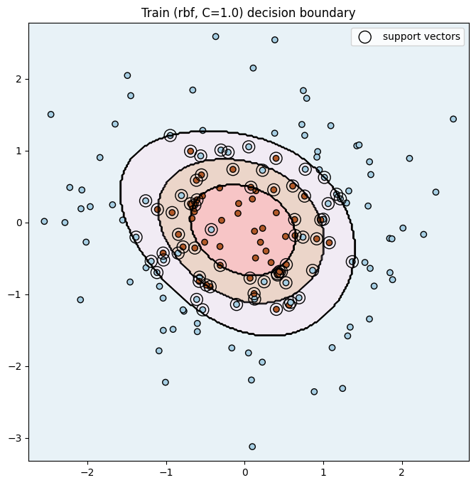

# Support Vector Machines

Five Support Vector Machine (SVM) implementations in Python, each solved as a quadratic program with the `cvxopt` library:

- **version1.py**: Simple Primal SVM (hard margin)
- **version2.py**: Primal SVM with Slack Variables (soft margin)
- **version3.py**: Simple Dual SVM (linear kernel)
- **version4.py**: Dual SVM with Kernel (linear, polynomial and RBF kernels)
- **version5.py**: Soft-margin Dual SVM with Kernel (box constraints $0 \le \alpha_i \le C$)

---

## Theory

Please note that the theory corresponding to the codes is hosted on this [page](https://parag1604.github.io/notes/Machine-Learning/Support-Vector-Machines)

## Python Environment Setup

Use Python >= 3.10 and install the requirements:

```bash
pip install -r requirements.txt
```

- Numpy - required for vectorized operations
- Matplotlib - required for plotting
- cvxopt - the quadratic program solver
- scikit-learn - optional, only for the `--compare` check in version5

## Data

`utils.py` generates small synthetic 2-D datasets (two Gaussian blobs, and points inside/outside the unit circle), splits them into train and test sets, and plots decision boundaries.

All versions use labels $y_i \in \{-1, +1\}$ and solve problems of the form `cvxopt.solvers.qp(P, q, G, h, A, b)`:

$$
\min_z \frac{1}{2} z^\top P z + q^\top z \quad \text{subject to } Gz \le h,\ Az = b
$$

- **P**: the quadratic part of the objective. For the dual forms it is the (linear or kernel) Gram matrix weighted by the labels.
- **q**: the linear part of the objective, e.g. $-1$ for each $\alpha$ in the dual.
- **G, h**: inequality constraints, e.g. $-\alpha \le 0$.
- **A, b**: the equality constraint of the dual forms, $\sum_i \alpha_i y_i = 0$.

## Running

Each script generates a dataset, trains the SVM, prints the train/test accuracy, and plots the decision boundary ($f(x) = 0$) together with the margin lines ($f(x) = \pm 1$) for the train and test sets.

### 1. Simple Primal SVM

```bash
python version1.py
```

- **Formulation**:

$$
\min_{w, b} \frac{1}{2} \|w\|^2 \quad \text{subject to } y_i (w^\top x_i + b) \geq 1
$$

- **cvxopt variables** ($z = [w, b]$):
  - `P`: identity matrix for $w$ and $b$ (last diagonal entry set to 0, so $b$ is not penalised).
  - `q`: zero vector.
  - `G`: $-y_i [x_i, 1]$ for each sample (encodes $y_i(w^\top x_i + b) \geq 1$).
  - `h`: $-1$ vector.

The blobs are well separated, so every training point lies on or outside the margin (train accuracy 1.000, test accuracy 0.975).

### 2. Primal SVM with Slack Variables

```bash
python version2.py --C 0.5
```

- **Formulation**:

$$
\min_{w, b, \xi} \frac{1}{2} \|w\|^2 + C \sum_i \xi_i \quad \text{subject to } y_i (w^\top x_i + b) \geq 1 - \xi_i, \quad \xi_i \geq 0
$$

- **cvxopt variables** ($z = [w, b, \xi]$):
  - `P`: block matrix, identity for $w$ and zeros for $b$ and the slack variables $\xi$.
  - `q`: $C$ for the slack variables, 0 for $w$ and $b$.
  - `G`: stacks the margin constraints $-y_i [x_i, 1] z - \xi_i \le -1$ and the slack constraints $-\xi_i \leq 0$.
  - `h`: $-1$ for the margin constraints, $0$ for the slack constraints.

New: the blobs now overlap, so some points must violate the margin. Try `--C 0.01` (wide margin, many violations) and `--C 100` (close to the hard margin).

### 3. Simple Dual SVM

```bash
python version3.py
```

- **Formulation**:

$$
\max_{\alpha} \sum_i \alpha_i - \frac{1}{2} \sum_{i,j} \alpha_i \alpha_j y_i y_j x_i^\top x_j \quad \text{subject to } \alpha_i \geq 0, \ \sum_i \alpha_i y_i = 0
$$

- **cvxopt variables**:
  - `P`: $y_i y_j x_i^\top x_j$ Gram matrix.
  - `q`: $-1$ vector.
  - `G`: $-\alpha \leq 0$.
  - `h`: $0$ vector.
  - `A`: $y^\top$ (equality constraint).
  - `b`: $0$.

New: the same data and classifier as version1, but solved for one multiplier per point. Only the support vectors (circled in the plot, 3 of them here) have $\alpha_i > 0$; $w = \sum_i \alpha_i y_i x_i$ matches version1.

### 4. Dual SVM with Kernel

```bash
python version4.py --kernel rbf --sigma 1.0
python version4.py --kernel poly --degree 2
python version4.py --kernel linear
```

- **Formulation**: same as version3, but $x_i^\top x_j$ is replaced by $K(x_i, x_j)$ for a chosen kernel.
- **cvxopt variables**:
  - `P`: $y_i y_j K(x_i, x_j)$ kernel Gram matrix.
  - Other variables as in version3.

New: the data is a circle (class 1 outside the unit circle), which no line separates. With `--kernel linear` the hard-margin QP is infeasible and the solver fails; the degree-2 polynomial and RBF kernels separate the training set perfectly. Here `sigma` is the RBF bandwidth, $K(x,z) = \exp(-\|x-z\|^2 / 2\sigma^2)$ (scikit-learn's `gamma` equals $1/2\sigma^2$).

### 5. Soft-margin Dual SVM with Kernel

```bash
python version5.py --kernel rbf --sigma 1.0 --C 1.0 --compare
python version5.py --kernel poly --degree 2 --C 1.0 --compare
```

- **Formulation**: the dual of version2's soft-margin primal, with a kernel. The slack variables disappear from the dual; their only trace is an upper bound $C$ on every multiplier:

$$
\max_{\alpha} \sum_i \alpha_i - \frac{1}{2} \sum_{i,j} \alpha_i \alpha_j y_i y_j K(x_i, x_j) \quad \text{subject to } 0 \le \alpha_i \le C, \ \sum_i \alpha_i y_i = 0
$$

- **cvxopt variables**:
  - `P`, `q`, `A`, `b`: as in version4.
  - `G`: $[-I;\ I]$ (stacked), encoding $-\alpha \le 0$ and $\alpha \le C$.
  - `h`: $[0;\ C\mathbf{1}]$.
- **Bias**: by the KKT conditions, points with $\alpha_i = 0$ are outside the margin, points with $0 < \alpha_i < C$ lie exactly on it ($y_i f(x_i) = 1$), and points with $\alpha_i = C$ are inside the margin or misclassified. Only the middle group satisfies $y_s f(x_s) = 1$, so $b = y_s - \sum_j \alpha_j y_j K(x_j, x_s)$ is averaged over the **margin support vectors** $0 < \alpha_s < C$ only.

New: the circle data of version4 now has noise on the radius, so the classes overlap and the hard-margin version4 would fail. `--compare` fits scikit-learn's `SVC` with the same kernel and $C$ (with `gamma` $= 1/2\sigma^2$) and compares the two.

What was run (MacBook CPU, a fraction of a second per fit; 160 train / 40 test points, seed 2023):

| kernel | $C$ | SVs (ours / sklearn) | margin SVs | train acc | test acc | max \|decision diff\| vs sklearn |
|---|---|---|---|---|---|---|
| rbf, $\sigma=1$ | 0.1 | 112 / 111 | 5 | 0.869 | 0.775 | 5.5e-4 |
| rbf, $\sigma=1$ | 1 | 68 / 68 | 8 | 0.869 | 0.800 | 2.1e-4 |
| rbf, $\sigma=1$ | 10 | 52 / 52 | 9 | 0.900 | 0.775 | 4.3e-6 |
| rbf, $\sigma=1$ | 100 | 51 / 51 | 13 | 0.906 | 0.775 | 7.2e-5 |
| poly, degree 2 | 1 | 54 / 54 | 5 | 0.894 | 0.775 | 9.6e-6 |
| linear | 1 | 160 / 116 | 105 | 0.656 | 0.650 | 2.5e-7 |

Predictions agree with scikit-learn on 100% of train and test points in every run, and the biases agree to 3–4 decimals. The support-vector counts match except for borderline multipliers: at $C=0.1$ one $\alpha_i$ sits at the tolerance, and with the linear kernel the circle data gives $w \approx 0$, so the dual has many optimal solutions and the two solvers pick different ones (with the same decision function).



*Training set with the decision boundary ($f(x) = 0$), the margin lines ($f(x) = \pm 1$) and the support vectors circled (`python version5.py --C 1 --save static/version5_rbf_C1.png`).*

## Exercise

Re-run version5 with `--C 0.01` and `--C 1000`. How do the number of support vectors and the margin width change? Which $C$ would you pick, and how would you choose it without looking at the test set?
